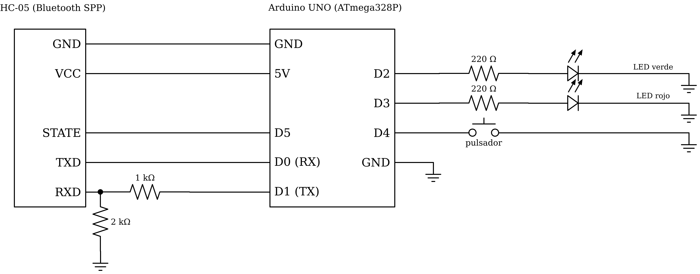

# Uso práctico de Arduino – Entrega 2: Bluetooth con HC-05

**Módulo Internet de las cosas — Politécnico Grancolombiano**
Luis Eduardo Ortiz Perea · leduortiz@poligran.edu.co · Grupo 5 · Tutor: Jesús Antonio Figueroa Guerrero

Un Arduino UNO recibe órdenes por Bluetooth a través del módulo HC-05, conectado al UART (D0/D1) según la Fig. 2 de la guía, y controla dos LED. El repositorio incluye el firmware, el banco de pruebas automatizado en simavr, el proyecto de Wokwi, los scripts de medición y análisis, y los registros originales de todas las ejecuciones.

- **Artículo (IEEE):** [`docs/articulo/Entrega2_Arduino_IEEE_Ortiz_Perea.pdf`](docs/articulo/Entrega2_Arduino_IEEE_Ortiz_Perea.pdf)
- **Simulación en Wokwi:** https://wokwi.com/projects/481514518773608449 (archivos en [`wokwi/`](wokwi/))

## Circuito

| HC-05 | Arduino UNO | Nota |
|---|---|---|
| TXD | D0 (RX) | directo (3,3 V es "1" para el UNO) |
| RXD | D1 (TX) | **divisor 1 kΩ / 2 kΩ** (5 V → 3,3 V) |
| STATE | D5 | alto = enlace establecido |
| VCC / GND | 5 V / GND | |

LED verde en D2 y LED rojo en D3 (220 Ω a GND); pulsador en D4 a GND (pull-up interno).



## Protocolo (9600 baudios, 8N1, una orden por línea)

| Orden | Acción | Respuesta |
|---|---|---|
| `V1` / `V0` | LED verde on/off | `OK V1` / `OK V0` |
| `R1` / `R0` | LED rojo on/off | `OK R1` / `OK R0` |
| `S` | estado | `ST V=.. R=.. BTN=.. BT=.. CPU=.. LOOPS=.. OK=.. ERR=..` |
| `P` | ping | `PONG n` |
| `E texto` | eco | `E texto` |
| `?` | ayuda | lista de órdenes |

Eventos espontáneos: `EV BTN 0|1` (pulsador con antirrebote), `EV BT 0|1` (enlace; al perderse se apagan los LED) y telemetría `#T,t_ms,cpu_x10,loops,bytes_rx,ok,err,descartadas,verde,rojo,enlace` cada segundo.

## Estructura

```
firmware/
  bt_hc05/bt_hc05.ino                  firmware final (v2): cola de salida no bloqueante, sleep y medición de CPU
  bt_hc05_v1_bloqueante/               primera versión (Serial.print bloqueante), conservada para comparar
  Makefile.mk                          compila con avr-gcc y el núcleo oficial ArduinoCore-avr
testbench/
  tb_hc05.c                            banco de pruebas en simavr: modelo HC-05, teléfono virtual, pulsador con rebotes
  simavr-uart-paridad.patch            corrección del cálculo de bits por byte del UART de simavr 1.6
  Makefile.mk
wokwi/
  sketch.ino, diagram.json             proyecto Wokwi
  hc05.chip.json, hc05.chip.c          chip personalizado que emula el HC-05 (puente UART + STATE)
scripts/
  campana.py                           ejecuta las configuraciones (5 repeticiones) y mide CPU/memoria del sistema operativo
  analisis.py                          calcula latencias, pérdidas, CPU, etc. -> datos/resultados.json
  figuras.py, esquema.py               figuras del artículo
datos/registros_originales.zip          registros originales de cada ejecución (descomprimir en datos/)
  monitor_serie.csv                    todo lo que la placa envió por el UART (con marca de tiempo)
  telefono_ordenes.csv, telefono_tx.csv, telefono_rx.csv   lo que envió y recibió el teléfono virtual
  pines.csv                            cambios de LED, pulsador, STATE
  cpu_referencia.csv                   ciclos activos/dormidos por segundo según simavr
  host.csv, cpu_proceso.json           indicadores del sistema operativo (psutil, getrusage)
  resumen.json
datos/resultados.json                  resultados agregados que usa el artículo
docs/articulo/                         artículo (.docx/.pdf) y su generador
```

## Reproducir

```bash
# Ubuntu 24.04
sudo apt install gcc-avr avr-libc simavr libsimavr-dev libelf-dev
git clone --depth 1 https://github.com/arduino/ArduinoCore-avr.git ../ArduinoCore-avr

# simavr 1.6 con la corrección del UART (para tb_hc05_corr)
git clone --branch v1.6 https://github.com/buserror/simavr.git ../simavr-src
patch -d ../simavr-src -p0 < testbench/simavr-uart-paridad.patch   # o aplicar el cambio a mano
make -C ../simavr-src/simavr RELEASE=1 libsimavr

make -C firmware -f Makefile.mk                        # v2 con sleep
make -C firmware -f Makefile.mk VARIANTE=busy          # v2 sin sleep
make -C firmware -f Makefile.mk SKETCH=bt_hc05_v1_bloqueante
make -C testbench -f Makefile.mk SIMAVR_SRC=../../simavr-src

pip install psutil matplotlib numpy schemdraw
python3 scripts/campana.py --reps 5     # ~25 min
python3 scripts/analisis.py
python3 scripts/figuras.py
```

Una ejecución suelta: `testbench/tb_hc05_corr firmware/build_bt_hc05_sleep_9600/bt_hc05.elf /tmp/salida --ff`

## Configuraciones medidas

| Configuración | Descripción |
|---|---|
| `v2_sleep_tiempo_real` | firmware final; simavr sincroniza con el reloj real mientras el AVR duerme (por defecto) |
| `v2_sleep_avance_rapido` | ídem, sin sincronizar (`--ff`) |
| `v2_busy` | firmware final sin sleep |
| `v1_bloqueante` | primera versión, respuestas con `Serial.print()` bloqueante |
| `v2_simavr_original` | firmware final con simavr 1.6 sin corregir |
| `reposo_*` | 20 s de reposo: LED apagados, LED encendidos y sin el sondeo de INT0/INT1 de simavr |

## Hallazgos sobre simavr 1.6

1. **UART:** `avr_uart_baud_write()` cuenta siempre un bit de paridad (11 bits por byte en 8N1), así que el enlace simulado va un 9 % más lento que el real. El parche solo cuenta la paridad si `UPMn1:0 ≠ 0`.
2. **Pull-up:** al escribir en PORTx, simavr vuelve a aplicar el pull-up interno de las entradas por encima del nivel externo; el banco declara el nivel externo de D4/D5 con `AVR_IOCTL_IOPORT_SET_EXTERNAL`.
3. **INT0/INT1:** mientras D2/D3 están en bajo, simavr consulta la interrupción por nivel en cada ciclo aunque esté deshabilitada; simular reposo cuesta 13 veces más con los LED apagados que encendidos (`--sin-sondeo` lo desactiva).
